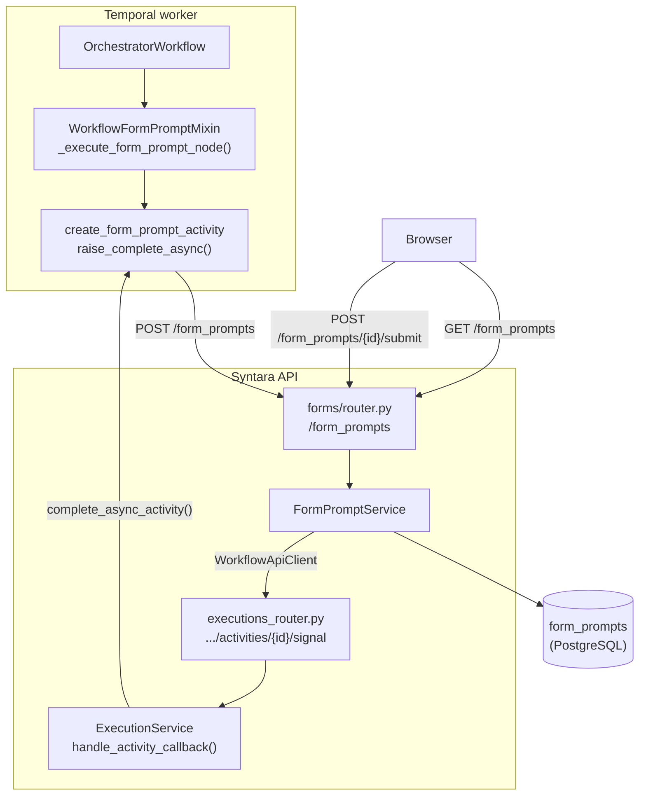
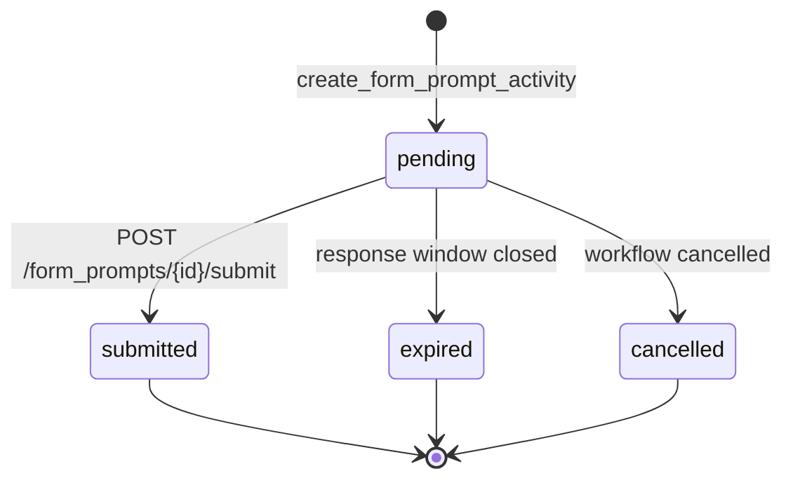
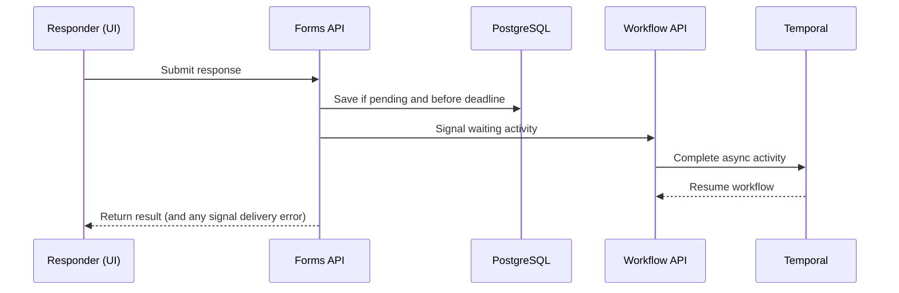
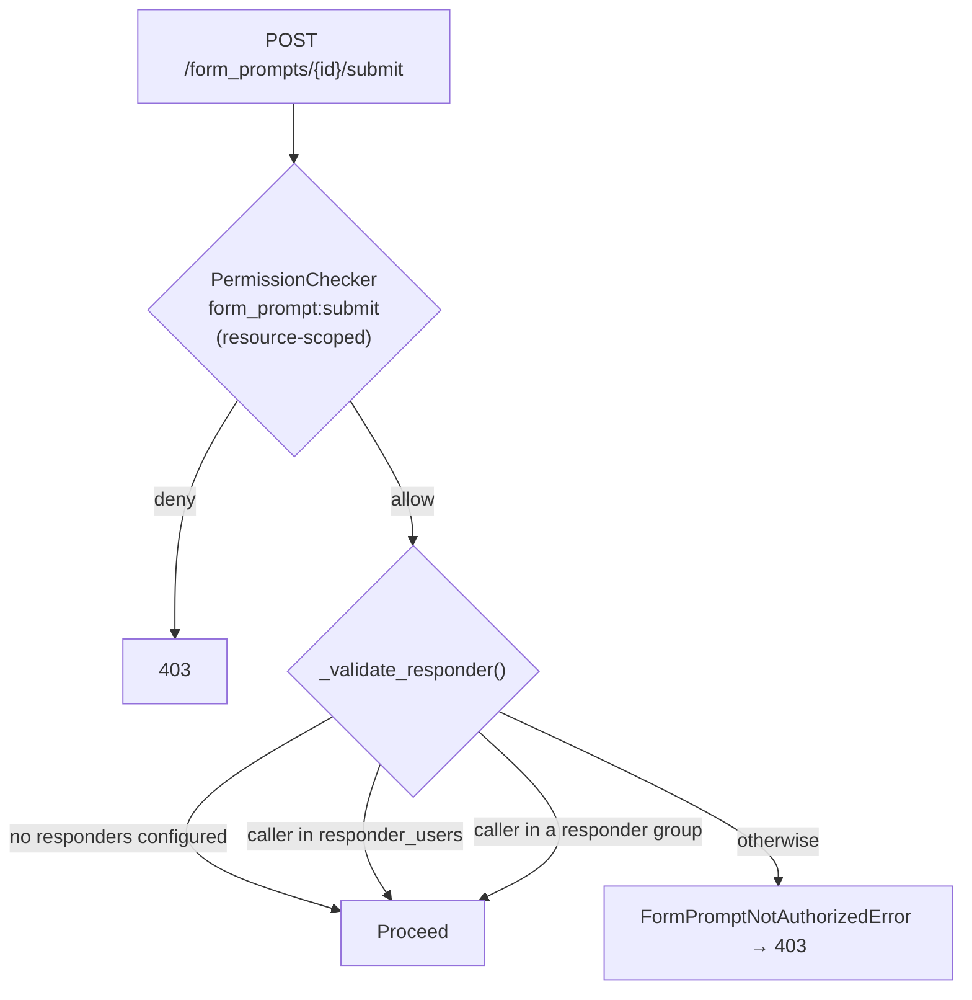

# Form Prompt Overview

A form prompt pauses a workflow and collects typed answers. A valid response resumes the
workflow through `submitted`; if the prompt times out, the workflow follows its configured
outcome. Other branches can continue and finish while the prompt is pending. Unlike an
approval, which collects a yes/no decision, a form prompt collects structured answers.

> This overview describes the feature's architecture and behavior. See
> [Form Definitions and Fields](#form-definitions-and-fields) for field types and
> [API Surface](#api-surface) for API shapes.

The sections follow the feature's own lifecycle: what an author defines, what the engine
creates when the step runs, what comes back when someone answers, and what happens when
nobody does.

## System Architecture

The worker creates a prompt and pauses; the browser submits a response that resumes the
workflow.

Key properties:

- **`forms/` owns prompts; `workflows/` owns the step.** The forms domain owns prompt
  records, field definitions, validation, authorization, and audit events. The workflows
  domain owns the step and its execution.
- The worker creates prompts through the Forms API, which signals the workflow after
  submission.
- Temporal tracks whether the step is waiting; Postgres stores the prompt shown to the
  responder and its response.

## Form Definitions and Fields

A `FormDefinition` is an ordered list of fields with unique `value_name`s. Downstream steps
use those names to read answers. Definitions reject unknown properties and enforce limits
on field, label, and option counts.

Nine field types exist: `text`, `textarea`, `masked_text`, `email`, `number`, `checkbox`,
`date`, `dropdown`, and `multi_select`. One note on the shape of that list:

- **`date`** can collect a date, a time, a timezone, or a combination. This lets a workflow
  ask for only the details it needs, using one `date` field type.

### Options

`dropdown` and `multi_select` fields can use a fixed list or options generated from earlier
workflow steps. When the prompt is created, the engine resolves generated options and saves
them with the prompt. Responders see that saved list, and their answers are checked against
the same list.

## The Form Prompt Step

A `form_prompt` step has two output ports, `submitted` and `fallback`. The `fallback` port is only reachable when the step's
`continue_on_failure` setting is enabled.

### Responders

`responder_users` and `responder_groups` limit who can answer. They use usernames and group
names so references survive workflow export and import. The names are resolved when the
step starts; unresolved names are ignored. If both lists are empty, anyone with project
permission to submit can respond.

### The response window

The step's `response_window` parameter, or the
`workflow_engine.form_prompt_response_window_seconds` runtime setting (default 24 hours)
when the parameter is absent, sets how long a responder has. It becomes an absolute instant,
`timeout_at`, when the step starts — fixed from that moment, so changing the runtime setting
mid-flight does not move a running prompt's deadline.

Human-in-the-loop steps use dedicated parameters — `response_window` here,
`decision_window` for approvals — because `settings.timeout` is reserved for bounding
machine execution. See [Node Settings](../workflow-engine/node-settings.md) and
[Runtime Settings](../runtime-settings.md).

### Save-time validation

Defaults are checked using the same rules as submitted answers. The workflow validator also
checks constraints JSON Schema cannot express, such as valid calendar dates and defaults
that match the selected date components or an option list. Drafts can save with validation
issues; `/workflows/validate` returns `422`, and publishing returns `409`.

## Creating the Prompt

There is no separate form resource. Authors define `form_definition` in a workflow step,
which is the source of truth. At runtime, each prompt stores a snapshot of that definition
and its presentation fields alongside the response. Workflow edits do not change the form an
in-flight responder sees.

Status moves from `pending` to `submitted`, `expired`, or `cancelled`. The latter three are
terminal states:

### One prompt per step, per loop iteration

Worker retries can happen after a prompt is created. A unique key on execution, node, and
loop iteration prevents duplicate prompts while allowing one prompt per loop pass.

### The pause

Prompts can wait for days, so the worker creates the prompt and completes the activity
asynchronously, freeing its worker slot. Temporal keeps the activity pending until a
response, timeout, or cancellation. Approvals, agentic steps, and wait steps use the same
signal-based pattern; see [Why Async Completion via Signals](../workflow-engine/workflow-engine-overview.md#why-async-completion-via-signals-approval-form-prompt-agentic-wait)
and [Approval Execution Pattern](../approvals/approval-execution-pattern.md).

The activity timeout follows the response window with a small buffer. It ends unanswered
waits and drives [timeout handling](#timeout-and-cleanup); the buffer does not extend the
submission window.

### Dispatch

`WorkflowFormPromptMixin` prepares the prompt by checking its route, resolving options and
responders, setting the deadline, and removing credentials from the message. Activity IDs
include loop indices so each loop iteration has a unique ID. See
[Dispatching to Activities](../workflow-engine/workflow-engine-overview.md#dispatching-to-activities)
for replay requirements.

## Responding

A prompt can be submitted once. `pending` is the only nonterminal status;
`submitted`, `expired`, and `cancelled` are terminal. The batch endpoint can expire or cancel
prompts, but cannot submit on a user's behalf.

Submission validation applies defaults, checks required fields and options, and converts
values to their expected types:

- All field errors are returned together.
- Empty optional values are omitted from `response_data`; `false` remains a valid checkbox
  answer.
- Multi-select accepts a single browser value as a one-item list, and checkbox accepts
  common form values.

### Resume

The Forms API saves a response only while the prompt is pending and before its deadline.
This lets one submission win when responses race each other or the timeout.

After saving, the API signals the workflow. If signaling fails, the response remains saved
and the failure is surfaced to the responder; Temporal's timeout still ends the wait.

Only submitted responses arrive by signal. Timeout and cancellation use their own workflow
paths. Downstream steps read answers as `${<step_id>.response_data.<value_name>}`.

## Timeout and Cleanup

Temporal's activity timeout handles unanswered prompts. The workflow marks the prompt
expired on a best-effort basis, then applies `continue_on_failure` and `fallback_decision`:

| `continue_on_failure` | `fallback_decision` | Result |
|---|---|---|
| `false` | — | The step fails and the workflow fails |
| `true` | `fallback` (default) | Route out the `fallback` port |
| `true` | `submit` | Route out the `submitted` port with an empty output |

With `fallback_decision: submit`, an expired prompt leaves through `submitted` with empty
output. The workflow skips the untaken branch.

### Cancellation and detachment

When a workflow is cancelled or finishes while prompts remain pending, the engine best-effort
updates those prompts and resolves their waiting activities. Cleanup errors do not fail the
workflow. If a workflow is terminated outside these cleanup paths, there is no sweeper; see
[Scope and Non-Goals](#scope-and-non-goals).

## API Surface

`/form_prompts` serves browsers and the Temporal worker. Browsers list, read, and submit
prompts under RBAC; the worker creates prompts and updates their status in batches using
service authentication. On submission, the Forms API asks the workflow service to signal the
waiting activity.

The API returns a creation receipt to the worker, a full prompt to the responder, and a
compact row for task lists. See the [Forms API specification](../../src/syntara/schemas/forms/openapi.yaml)
and [OpenAPI Spec Management](../standards/openapi-spec-management.md).

## Authorization

Submitting a response passes two independent checks, and both must succeed.

**Tier 1 — RBAC.** A resource-scoped `PermissionChecker` resolves the prompt's project and
evaluates the policy in that scope. The list endpoint instead uses a `VisibilityFilter` and
scopes the query to the caller's allowed projects.

| Action | System roles | Project roles |
|---|---|---|
| `form_prompt:create` | admin | — (service-to-service only) |
| `form_prompt:read` | admin, auditor | project-admin, project-user, project-auditor |
| `form_prompt:submit` | admin | project-admin, project-user |

**Tier 2 — the responder list**, checked inside the service where the relationships are
loaded. Naming responders **narrows** tier 1, never widens it: a listed user still needs
`form_prompt:submit`.

The worker calls create and batch as an mTLS service principal, bypassing tier 1 entirely;
when S2S TLS is disabled for local development those endpoints fall back to admin-only. See
[S2S Certificate Authentication](../s2s-cert-authentication.md).

One authorization carve-out is specific to this feature: the builder's responder picker
needs to list who *could* answer a prompt, which is an authz introspection query a workflow
author may not otherwise be allowed to run. `authz/router.py` gates it narrowly — someone
who can edit workflows in a project may ask who can submit form prompts there — rather than
granting general introspection. Approvals have the equivalent carve-out.

## Observability

Three audit events live in `forms/audit/form_prompt.py`, all workflow-category events keyed
on a form prompt URN:

| Event | Severity | Actor | Payload |
|---|---|---|---|
| `form_prompt_created` | INFO | SYSTEM | Dispatched **inside the create transaction** via the transactional outbox, so prompt and audit row commit atomically |
| `form_prompt_submitted` | INFO | Resolved from the principal | `outcome`, `submitted_at`, `wait_time_ms`, `field_count` |
| `form_prompt_expired` | WARNING | SYSTEM | `expired_at`, `timeout_at` |

Submission audit events contain metadata, never submitted values. Responses remain in
`form_prompts` behind normal access controls, so `masked_text` needs no special audit
handling.

Telemetry errors are swallowed so they cannot affect a submission.

Handoff latency uses a monotonic clock within one process; resume latency uses Temporal
history timestamps. Neither metric compares clocks across hosts.

Errors use RFC 9457 problem details. See [Audit](../audit.md) and
[Observability](../standards/observability.md).

## Related Documentation

- [Adding a Form Prompt Field Type](form-prompt-field-development.md) — contributor checklist
  for adding and wiring a field type
- [Form Trigger Milestone Proposal](form-trigger-milestone-proposal.md) — the planned
  pre-execution sibling; records what is reusable from the shared form layer and why file
  upload and secret storage are out of scope
- [Workflow Engine Architecture](../workflow-engine/workflow-engine-overview.md) — graph
  execution, async completion, and live-status sync shared by every step type
- [Approval Overview](../approvals/approval-overview.md) — the sibling human-in-the-loop step
- [Approval Execution Pattern](../approvals/approval-execution-pattern.md) — the
  async-completion/signal pattern in detail
- [Node Settings](../workflow-engine/node-settings.md) — settings tiers, timeout, and
  continue-on-failure resolution
- [Runtime Settings](../runtime-settings.md) — the settings catalog and resolution order
- [Expression System](../workflow-engine/expression-system.md) — the `${...}` namespace
- [Authorization](../authorization.md) — RBAC, PermissionChecker, VisibilityFilter
- [Audit](../audit.md) — audit event pipeline and transactional outbox
- [Forms API Specification](../../src/syntara/schemas/forms/openapi.yaml)
