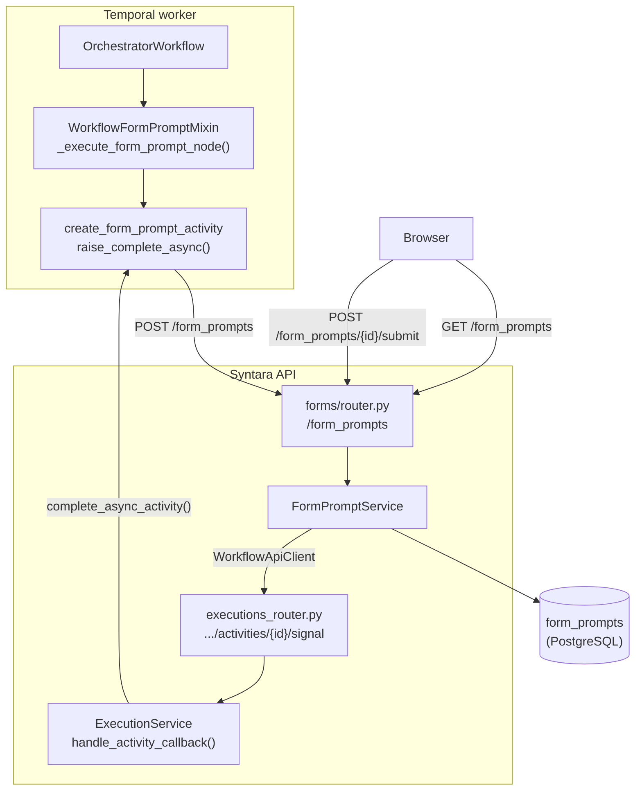
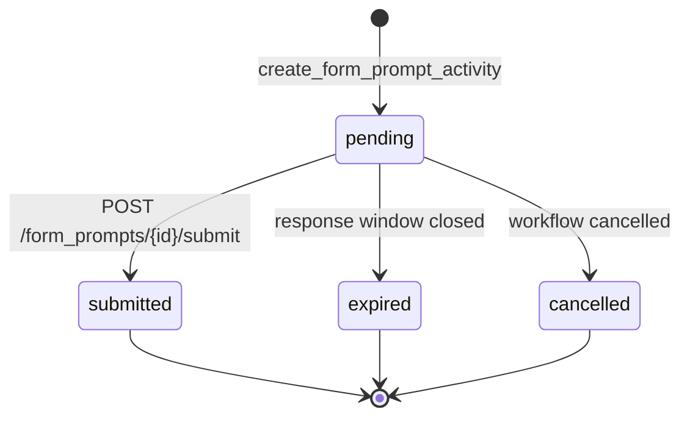
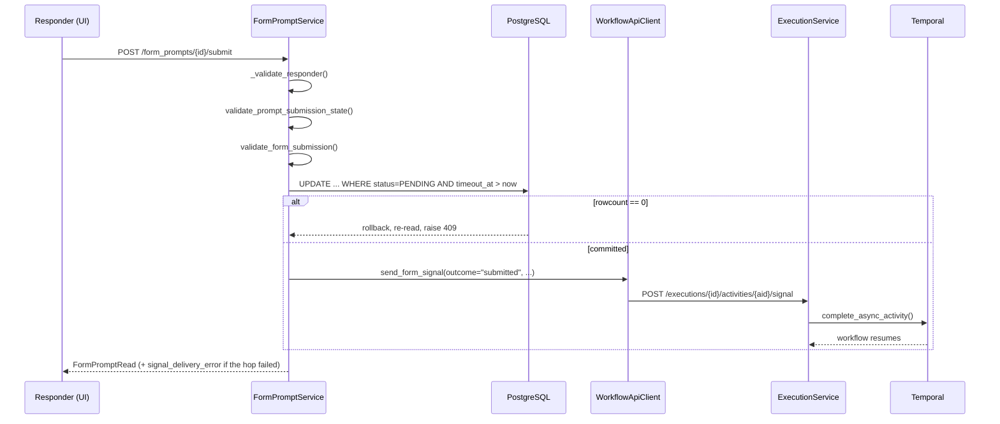
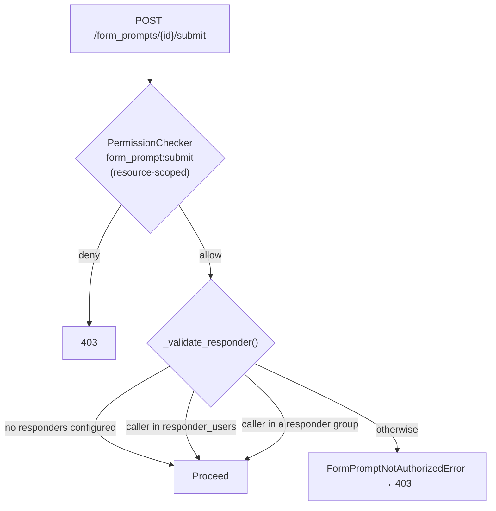

# Form Prompt Overview

A form prompt is a step type that pauses workflows and requests structured input via a human-readable form. A valid response resumes the workflow through a branch on the `submitted` node port path. Form prompts can be configured to timeout, in which case the behavior is configurable via settings to take either the submitted or failure path. Other parallel branches can continue while form prompts wait for a response, and may finish the workflow while the prompt is still pending. It is Syntara's general-purpose human-data-collection node, similar to the approval node. Where the approval asks for a yes/no decision, a form prompt asks for an arbitrary set of typed questions.

This document covers the backend: the data model, the form definition and its validation, the API contract, the Temporal execution lifecycle, authorization, and observability.

## System Architecture

Four participants, and the control flow runs in both directions between them. The workflow engine creates a prompt and then stops; the UI answers it and pushes the workflow back into motion.



### File Layout

| Path | Responsibility |
|---|---|
| `forms/router.py` | `/form_prompts` endpoints — create, list, get, submit, batch |
| `forms/services/form_prompt_service.py` | `FormPromptService` — the only writer of `form_prompts` rows |
| `forms/models/form_prompt.py` | `FormPrompt` table, `FormPromptRead`, `FormPromptListRead` |
| `forms/models/form_fields.py` | Field type union, `FormDefinition`, option sources |
| `forms/models/api_models.py` | `FormPromptStatus`, the transition table, request/response models |
| `forms/validators/submission.py` | `validate_form_submission`, per-type coercers |
| `forms/validators/options.py` | `resolve_dynamic_options` — the runtime options snapshot |
| `forms/validators/form_definition.py` | `validate_form_definition` — authoring-time default checks |
| `forms/audit/form_prompt.py` | Created / submitted / expired audit events |
| `forms/clients/workflow_client.py` | `WorkflowApiClient.send_form_signal` — the resume hop |
| `workflow_engine/form_prompt_mixin.py` | `WorkflowFormPromptMixin` — node orchestration and cleanup |
| `workflow_engine/activities/form_prompt_activity.py` | Create, expire, cancel, and detach activities |
| `workflows/clients/form_prompts_client.py` | `FormPromptsApiClient` — worker → Forms API, with retry |

### Why Async Completion Rather Than a Timer

A form prompt can remain in pending for a long period of time (days). Holding a synchronous Temporal activity open that long would pin a worker slot the entire time, so `create_form_prompt_activity` does its one main operation — `POST /form_prompts` — and then calls `activity.raise_complete_async()`. The function is typed `-> NoReturn` because it never returns normally: the activity stays in Temporal's `STARTED` state with no worker attached, and **that suspended activity is the pause**.

There is no `workflow.wait_condition`, polling loop, or separate Temporal timer for this node. The response window sets `timeout_at`; the Forms API checks that cutoff before accepting a submission and repeats it in the conditional `UPDATE`, so a response after `timeout_at` is rejected. Separately, the async activity's `start_to_close_timeout` is `response_window + _TEMPORAL_MARGIN` (10 s). That later Temporal timeout ends a still-pending wait and invokes the workflow's timeout and continue-on-failure handling; the margin does not extend the time allowed for a response. Both deadlines are fixed when the node starts, so changing the runtime setting mid-flight moves neither one.

This is the same pattern approval, agentic, and wait nodes use; see [Workflow Engine Architecture](../workflow-engine/workflow-engine-overview.md#why-async-completion-via-signals-approval-form-prompt-agentic-wait) for the shared mechanics and [Approval Execution Pattern](../approvals/approval-execution-pattern.md) for the closest analogue.

## Data Model

### The `form_prompts` table

`FormPrompt` (`forms/models/form_prompt.py`) extends `BaseResource`, so it inherits `id`, `created_at`, `updated_at`, and `labels`.

| Column | Type | Notes |
|---|---|---|
| `project_id` | UUID FK → `projects.id` | Denormalized from the execution so list filtering and visibility scoping never need a join |
| `name` | str | Display name; defaults to `Form prompt for {node_id}` when the node is unnamed |
| `message` | str? ≤2000 | Resolved, credential-scrubbed guidance text |
| `execution_id` | UUID, indexed | **Soft reference — no foreign key.** Prompts outlive their execution row's lifecycle management |
| `prompt_node_id` | str | The **canvas** node ID, never a Temporal or loop-iteration ID |
| `loop_iteration_path` | JSONB `int[]` | Enclosing-loop indices, outermost first; `[]` outside a loop |
| `status` | PG enum `formpromptstatus` | Indexed, `server_default 'pending'` |
| `notes` | str? | Why the last status change happened, e.g. a cancellation reason |
| `timeout_at` | timestamptz?, indexed | When the prompt expires |
| `form_definition` | `DiscriminatedJSONB(FormDefinition)` | NOT NULL; the snapshot the responder sees and the submission is validated against |
| `submit_label` | str? ≤64 | Presentation, snapshotted at creation |
| `success_message` | str? ≤500 | Presentation, snapshotted at creation |
| `css_override` | str? ≤10000 | Presentation, snapshotted at creation |
| `response_data` | JSONB? | Coerced submitted values |
| `responded_at` | timestamptz? | |
| `responded_by` | UUID? FK → `users.id` | `ON DELETE SET NULL`; a deleted responder leaves the response intact |
| `temporal_activity_id` | str ≤512 | The handle to signal on submit — computed once at creation, never recomputed |

Two things on that table deserve emphasis. First, `form_definition` is **snapshotted**, not referenced: editing the workflow after a prompt is created does not change the form an in-flight responder sees, and cannot retroactively invalidate a submission. Second, `temporal_activity_id` is persisted rather than derived, so the submit path never has to reconstruct loop-suffix logic to find the right activity.

`temporal_activity_id` is excluded from `FormPromptRead` by `_to_read_model` — it is an internal engine handle, not something an API consumer should see or depend on.

### Idempotency

```python
__table_args__ = (
    UniqueConstraint(
        "execution_id", "prompt_node_id", "loop_iteration_path",
        name="uix_execution_prompt_node_path",
    ),
    Index("ix_form_prompts_labels", "labels", postgresql_using="gin"),
)
```

That unique constraint is the idempotency key for prompt creation. A Temporal activity retry — a worker restart between the `POST` and the response, say — hits the constraint and gets `FormPromptAlreadyRequestedError` (409) instead of creating a second prompt for the same node in the same loop iteration. Including `loop_iteration_path` in the key is what lets the same canvas node raise one prompt per iteration.

### Responder junction tables

`form_prompt_responder_users` and `form_prompt_responder_groups` (`forms/models/form_prompt_responders.py`) are plain two-column junction tables, both columns part of the primary key, both cascading on delete. They are loaded as `viewonly` relationships — the service writes them explicitly at creation and never mutates them afterward.

### Status state machine



```python
_ALLOWED_TRANSITIONS = {
    PENDING:   frozenset({SUBMITTED, EXPIRED, CANCELLED}),
    SUBMITTED: frozenset(),
    EXPIRED:   frozenset(),
    CANCELLED: frozenset(),
}

def can_transition(current, target) -> bool:
    return target in _ALLOWED_TRANSITIONS[current]
```

All three non-pending states are terminal. `BatchFormPromptStatus` is the system-actionable subset — `expired` and `cancelled` only — so the batch endpoint structurally cannot be used to mark something submitted on a user's behalf.

### `workflow_name` enrichment

The Tasks table needs each row's workflow name, but the detail endpoint does not, and `form_prompts` has no join path to `workflows` short of `Execution`. Rather than denormalize a third column, `workflow_name` is attached outside the class body as a **deferred** correlated scalar subquery (`select(Workflow.name).join(Execution)...`), undeferred only on the list path by `FormPromptEnrichQuery.enrich()`. Detail reads pay nothing for it; list reads get it in the same round trip; nothing has to be kept in sync on workflow rename.

`__filterable_fields__` covers `name`, `execution_id`, `project_id`, `status`, and `timeout_at`; `__sortable_fields__` adds `workflow_name` and `responded_at`.

### Migrations

The chain is `d5b8c2f04e71 → 2a78b3c49c72`.

- **`2a78b3c49c72_add_form_prompts_tables`** — creates `form_prompts` and both junction tables, and in a marked `# CUSTOM:` block runs `ALTER TYPE nodetype ADD VALUE IF NOT EXISTS 'form_prompt'`.

## Form Definition and Field Types

`FormDefinition.fields` is a 1–100 item list of a `Discriminator("type")` union. Every model in the chain sets `extra="forbid"`, and field `value_name`s must be unique within a definition.

Every field shares `FormFieldBase`: `value_name`, `label`, optional `placeholder` and `help_text`, and `required` (default `False`).

| `type` | Model | `default` type | Notes |
|---|---|---|---|
| `text` | `TextField` | `str` | |
| `textarea` | `TextAreaField` | `str` | |
| `masked_text` | `MaskedTextField` | `str` | Masked in the UI; **not** encrypted at rest — see [Observability](#observability) on what is and is not recorded |
| `email` | `EmailField` | `str` | Validated and domain-normalized through `TypeAdapter(EmailStr)`; no DNS lookup |
| `number` | `NumberField` | `float \| int` | Rejects `bool`, `NaN`, and `Inf` |
| `checkbox` | `CheckboxField` | `bool` (default `False`) | `required=True` means *must be ticked*, error code `must_be_checked` |
| `date` | `DateField` | `DateValue` | Component toggles, below |
| `dropdown` | `DropdownField` | scalar | Carries an `OptionsSource` |
| `multi_select` | `MultiSelectField` | `list[scalar]` | Carries an `OptionsSource` |

### Date fields

A `DateField` collects a combination of three components, selected by `include_date` (default true), `include_time`, and `include_timezone`. Two model validators constrain the combinations:

- At least one component must be included.
- `include_time` requires `include_timezone`. A bare wall-clock time is ambiguous without the zone it is read in, and the ambiguity would silently propagate into whatever downstream node consumes it.

A `default`, if present, must supply **exactly** the included components — no more, no fewer — so toggling a component later surfaces as an authoring error rather than a half-populated value at run time.

`DateValue` validates shape and reality separately: the `date` pattern proves `YYYY-MM-DD` shape, and a field validator then runs `date.fromisoformat` so `2026-02-30` is rejected rather than accepted as well-formed. `timezone` must resolve through `ZoneInfo`.

The coerced namespace value for a date field is always an **object**, never a bare string, even when only one component is collected. That costs a little verbosity in downstream expressions and buys a stable shape: adding `include_time` later does not reshape `${form.when}` from a string into a dict and break every expression reading it.

### Options

```python
OptionsSource = Annotated[
    StaticOptions | DynamicOptions | ResolvedOptions,
    Discriminator("source"),
]
```

| `source` | Authored by | Shape |
|---|---|---|
| `static` | Workflow author | `values: [{display_label, value: str}]`, 1–500. Values are string-only because a human typed them |
| `dynamic` | Workflow author | `{expression, label_key, value_key}` — an expression resolving to a non-empty array of objects |
| `dynamic_resolved` | **The engine only** | `values: [{display_label, value: str \| int \| float \| bool}]` |

The authored/produced split is enforced, not conventional: `FormPromptNodeParameters.validate_authored_form_definition` rejects a `dynamic_resolved` options block in a saved workflow outright, and the executor JSON Schema's `authoredOptions` enum omits it.

At node start, workflow expression resolution has already substituted each `DynamicOptions.expression` with its upstream value, so `resolve_dynamic_options` converts the whole thing into a `ResolvedOptions` **snapshot** — deduplicating by value (with a warning), capping at 500, requiring scalar values and string labels ≤200, then re-validating the definition. The snapshot, not the expression, is what gets persisted.

Snapshotting rather than resolving on each read is what makes the option list trustworthy: the list the responder chose from and the list their submission is validated against are the same bytes, even if the upstream data changed in between.

### Submission validation pipeline

`validate_form_submission` walks the definition's fields in order and, for each one:

1. Reads the raw submitted value.
2. Normalizes emptiness — `""`, `[]`, and `None` all count as *absent* — **except for checkbox**, where `False` is a real answer.
3. Applies the field's `default` if the value is absent.
4. Enforces `required` → code `required`.
5. Coerces via `coerce_field` → code `type` or `invalid_format` on failure.
6. Enforces required-checkbox → code `must_be_checked`.
7. Checks option membership for dropdown and multi-select → code `not_in_options`.

Then any submitted key not present in the definition is reported as `unknown_field`.

Two behaviors matter downstream. Errors **accumulate** across all fields and are raised once as `FormDataValidationError(list[FormFieldError])` → HTTP 422, so a responder fixes everything in one pass instead of discovering problems one at a time. And optional-and-absent fields are **omitted entirely** from `response_data` rather than written as `None` — a downstream expression can distinguish "not answered" from "answered with nothing".

`coerce_field` dispatches with `match` and closes with `assert_never(field)`, which makes adding a field type to the union a mypy error until the coercer handles it. Its per-type leniency is deliberately shaped around browser behavior: checkbox accepts `true/false/on/off/yes/no/1/0`; multi-select wraps a bare scalar into a one-element list (a single-selection `<select multiple>` posts a scalar) but rejects dicts; dropdown rejects both lists and dicts.

| Code | Raised when |
|---|---|
| `required` | No value supplied for a required field |
| `type` | Value is the wrong type and cannot be coerced |
| `invalid_format` | Right type, wrong format (bad email, malformed date) |
| `must_be_checked` | A required checkbox was not ticked |
| `not_in_options` | Value absent from the option list |
| `unknown_field` | Submitted key is not defined in the form |
| `invalid_default` | *Authoring-time:* a field default the submission coercer would reject |

That last code is what makes authoring-time and run-time agree: `validate_form_definition` runs each default through the same coercer a submission would hit, so a default that could never be submitted cannot be saved.

## API Contracts

Prefix `/form_prompts`, tag `Form Prompts`, defined in `forms/router.py`.

| Method | Path | `operation_id` | Permission | Request → Response |
|---|---|---|---|---|
| POST | `/form_prompts` | `create_form_prompt` | `form_prompt:create` | `FormPromptCreateRequest` → `FormPromptSummary` (201) |
| GET | `/form_prompts` | `list_form_prompts` | `VisibilityFilter(form_prompt, read)` | `FormPromptListParams` → `FormPromptListResponse` |
| POST | `/form_prompts/batch` | `batch_update_form_prompts` | `form_prompt:create` | `BatchFormPromptRequest` (1–100) → `BatchUpdateResponse` |
| GET | `/form_prompts/{form_prompt_id}` | `get_form_prompt` | `form_prompt:read` (resource-scoped) | → `FormPromptRead` |
| POST | `/form_prompts/{form_prompt_id}/submit` | `submit_form_prompt` | `form_prompt:submit` (resource-scoped) | `FormPromptSubmitRequest` → `FormPromptRead` |

Create and batch are service-to-service endpoints called by the Temporal worker, not by browsers. The resume direction uses an endpoint owned by the workflows domain: `POST /executions/{execution_id}/activities/{activity_id}/signal` (`workflows/executions_router.py`).

### Three read models

- **`FormPromptSummary`** — eight fields (`id`, `execution_id`, `project_id`, `prompt_node_id`, `name`, `status`, `loop_iteration_path`, `temporal_activity_id`). This is the create response and the internal engine contract. It deliberately carries no user-authored content and no rendering configuration: the engine has no reason to see them, so it is not given them.
- **`FormPromptRead`** — the full record, with `responder_users` / `responder_groups` as summaries and `responded_by` as a `UserReference` (falling back to a `DELETED_USER` reference when the user row is gone). It carries the transient `signal_delivery_error`, documented in its own field description as "only present in the respond response; null on subsequent reads."
- **`FormPromptListRead`** — the Tasks-table row: adds `workflow_id`, `workflow_version`, and `workflow_name`, and omits the form definition and presentation fields that a table never renders.

### Spec files

| File | Contents |
|---|---|
| `schemas/forms/openapi.yaml` | `Orchestrator Forms API` v1.2.0 — 4 paths, 5 operations, each annotated `x-app-permission`, 28 component schemas |
| `schemas/workflows/v2/executors/form_prompt.schema.json` | Node parameter and result contract |
| `schemas/workflows/v2/catalog/node_type_catalog.json` | `{"type": "form_prompt", "name": "Form", "category": "executor", "since": "2.0.0"}` |

See [OpenAPI Spec Management](../standards/openapi-spec-management.md) for how these bundle into the public spec and how drift is detected.

### Node parameters

`FormPromptNodeParameters` (`workflow_engine/models/workflow_definition.py`), `extra="forbid"` / `additionalProperties: false`:

| Parameter | Type | Notes |
|---|---|---|
| `form_definition` | `FormDefinition` | **Required.** Rejects `dynamic_resolved` options |
| `message` | str? ≤2000 | Supports `${...}` expressions |
| `responder_users` | list[str]? ≤100 | Usernames. Empty or omitted = anyone with `form_prompt:submit` |
| `responder_groups` | list[str]? ≤50 | Group names. Same fallback |
| `response_window` | int? ≥1 | Seconds. Falls back to the runtime setting |
| `fallback_decision` | `"submit" \| "fallback"` | Routing on timeout when continue-on-failure is enabled |
| `submit_label` | str? ≤64 | |
| `success_message` | str? ≤500 | |
| `css_override` | str? ≤10000 | Passed through `validate_css_security`, which rejects patterns enabling data exfiltration or code execution |

The node's `settingSchema` is `nodeSettingsNoRetry`, and `graph.py` maps `NodeType.FORM_PROMPT → NodeSettingsNoRetry`. Retrying a form prompt has no sensible meaning — the prompt either was answered or was not — so the option is removed rather than defaulted off.

### Node output

`resultSchema` is a `oneOf` discriminated on `status`. Completed: `{status: "completed", outcome, response_data, responded_by, responded_at, prompt_id}`. Failed: the same keys, all nullable, plus `error`. Downstream nodes read individual answers as `${<node_id>.response_data.<value_name>}`.

### Save-time graph validation

`workflows/validators/workflow_definition.py` emits two errors under `ValidationCategory.form_prompt_configuration`:

- **No `submitted` successor** — via the shared `_check_required_output_port` helper. A prompt with nowhere to send a response is always a mistake.
- **A `fallback` edge while `settings.continue_on_failure` is `False`** — the branch could never execute. The finding points at `settings.continue_on_failure`, because enabling that is the fix the author usually wants.

`_collect_form_prompt_model_findings` additionally re-runs the Pydantic `FormPromptNodeParameters` model over the raw node dict. JSON Schema cannot express calendar-date reality, default/component agreement, or default-in-option-list membership, so without this second pass those three classes of error would only surface at run time.

The resulting authoring contract: an invalid draft still **saves** with `201` and `has_validation_issues: true` plus a located `validation_result` finding; `POST /workflows/validate` returns `422`; publishing an invalid draft returns `409`. Drafts stay saveable mid-edit; only publishing is gated.

## Execution Lifecycle

### Node dispatch

`OrchestratorWorkflow` dispatches `form_prompt` to `WorkflowFormPromptMixin._execute_form_prompt_node`, which calls `_prepare_form_prompt_args` to do, in order:

1. **Runtime backstop for the save-time validator.** If `graph.get_next_activities_by_port(node.id, "submitted")` is empty, raise `SafeValueError`. The static validator already covers this, but a definition can reach the engine through paths that bypass it.
2. **Snapshot the options** — `resolve_dynamic_options(resolved_parameters["form_definition"])`.
3. **Resolve responders** — names to UUIDs, reusing `ActivityName.APPROVER_RESOLUTION` (it is generic), 3 attempts.
4. **Compute the deadline** — `resolve_form_prompt_response_window(node, runtime_settings)` reads `node.parameters.response_window`, else the `workflow_engine.form_prompt_response_window_seconds` catalog setting (default `86400`, i.e. 24 h). `timeout_at = workflow.now() + window`.
5. **Process the message** — `process_prompt_field` resolves, scrubs credentials, and truncates.

It returns a **strictly positional, append-only** 14-element argument list. The contract is spelled out in the function's docstring, and the append-only rule is load-bearing: Temporal replays an in-flight workflow's history against current code, so inserting an argument in the middle would break every execution started before the change. New arguments go on the end, always.

```python
result = await workflow.execute_activity(
    ActivityName.FORM_PROMPT,
    args=args,
    activity_id=prompt_activity_id,
    start_to_close_timeout=timedelta(seconds=window + self._TEMPORAL_MARGIN),
    retry_policy=resolve_retry_policy(node, self._runtime_settings),
)
```

`create_form_prompt_activity` then heartbeats `{HEARTBEAT_STOP_MONITOR: True}` (telling the activity monitor not to expect further heartbeats), rejects an empty `project_id` with a non-retryable `ConfigError`, `POST`s to the Forms API, and suspends.

### Loop-aware activity IDs

`form_prompt_temporal_activity_id(node_id, loop_body_map, node_control_data)` appends one `_iter_{n}` segment per enclosing loop, outermost first. Temporal requires activity IDs to be unique within a run, and an inner loop resets its counter on each outer iteration, so the full chain is needed rather than a single index.

The database splits the same information differently: `prompt_node_id` holds the plain canvas ID and `loop_iteration_path` holds the index chain, which is what makes "expire every prompt for this node" expressible as a query. `matches_loop_iteration_id` reconciles the two directions — matching a canvas ID against suffixed stored IDs and vice versa — so both per-iteration rows and legacy suffixed rows are covered.

### Resume



The write is an **optimistic-lock UPDATE**, not a read-then-write:

```python
stmt = (
    update(FormPrompt)
    .where(FormPrompt.id == prompt_id)
    .where(FormPrompt.status == FormPromptStatus.PENDING)
    .where(or_(FormPrompt.timeout_at.is_(None), FormPrompt.timeout_at > responded_at))
    .values(status=SUBMITTED, response_data=cleaned_data,
            responded_by=self.user.id, responded_at=responded_at)
)
result = await self.session.exec(stmt)
if result.rowcount == 0:
    await self.session.rollback()
    prompt = await self.session.get(FormPrompt, prompt_id)
    if prompt:
        validate_prompt_submission_state(prompt)
        raise FormPromptAlreadyRespondedError(prompt_id, prompt.status)
    raise FormPromptNotFoundError(prompt_id)
```

The state was already validated a few lines earlier; this re-states both conditions in SQL to close the TOCTOU window between that check and the write. Two responders submitting simultaneously produce exactly one winner, and the loser gets a precise error because the handler re-reads the row to find out *why* it lost. Note the deadline is enforced in SQL too — a submission racing the expiry boundary loses to it.

The signal is then sent **best-effort**, after the commit:

```python
try:
    async with WorkflowApiClient() as client:
        await client.send_form_signal(
            execution_id=prompt.execution_id,
            form_prompt_id=prompt.prompt_node_id,
            form_response={
                "outcome": "submitted",
                "response_data": cleaned_data,
                "responded_by": self.user.username,
                "responded_at": responded_at.isoformat(),
                "prompt_id": str(prompt_id),
            },
            temporal_activity_id=prompt.temporal_activity_id,
        )
except Exception:
    signal_error = "Workflow signal delivery failed"
```

A failed signal never reverts a committed submission. The response was given; losing the delivery hop is an engine problem, not grounds for telling the user their answer did not count. The failure surfaces as `signal_delivery_error` on that one response, and the activity's own `start_to_close_timeout` remains as the backstop, so the wait times out rather than hanging indefinitely. If `continue_on_failure` is disabled, the workflow fails; if enabled, `fallback_decision` selects the `fallback` port (the default) or the `submitted` port (`submit`).

`WorkflowApiClient` wraps the payload as `{"signal_data": form_response}` and `POST`s to `generate_activity_signal_url(execution_id, temporal_activity_id)`, with retry and backoff from `BaseHttpRetryClient`.

One subtlety at the receiving end: `ExecutionService.handle_activity_callback` routes on `signal_data["status"]`, failing the activity for `"failed"` and `"cancelled"` and **failing open to `complete_async_activity` for everything else**. The form prompt payload carries `outcome`, not `status`, so it always takes the fail-open branch. That is intended — the workflow routes on the output data, not on Temporal's activity state — but it means a malformed form-prompt payload resumes the workflow rather than failing it, and is then caught by the outcome check below.

### Conditional path routing

A form prompt node has two output ports: `submitted` and `fallback`.

```python
if outcome == "submitted":
    next_port = "submitted"
else:
    msg = f"Invalid form prompt outcome: {outcome!r}. Expected 'submitted'."
    raise ApplicationError(msg, {"output": output},
                           type="InvalidFormPromptOutcomeError", non_retryable=True)
return {"output": output, "control": {"next_port": next_port}}
```

Only `submitted` can legitimately arrive via signal — expiry and cancellation never reach this code path, because they resolve the activity as a failure instead. Anything else is a protocol violation and fails the node non-retryably rather than being quietly routed somewhere.

`_schedule_successors` reads `next_port`, and because `FORM_PROMPT` is in the engine's control-flow list, `_skip_non_taken_branches` marks the untaken subtree skipped so it never runs.

### Timeout

Temporal fires the activity's `start_to_close_timeout` and `execute_activity` raises `ActivityError(cause=TemporalTimeoutError)`. In `_process_completed_task`:

```python
except Exception as node_error:
    cof = resolve_continue_on_failure(node, self._runtime_settings)
    self._handle_node_failure(..., continue_on_failure=cof)
    await self._maybe_expire_form_prompt(completed_node_id, node, node_error)
    if cof:
        self._route_failed_node(completed_node_id, node)
        await self._handle_continued_failure(completed_node_id, node, graph, pending_tasks)
```

`_maybe_expire_form_prompt` fires only for a `FORM_PROMPT` node whose error is an `ActivityError` caused by a `TemporalTimeoutError`, and marks the DB row `expired` best-effort (`maximum_attempts=1`, inside a swallow-all `try/except`). The DB status is a reflection of the authoritative state, not the source of it — the Temporal timeout already decided the outcome, so failing to record it must not fail the run.

Routing then depends on continue-on-failure:

| `continue_on_failure` | `fallback_decision` | Result |
|---|---|---|
| `false` | — | The node fails and the workflow fails |
| `true` | `fallback` (default) | Route out the `fallback` port |
| `true` | `submit` | Route out the `submitted` port with an empty `FormPromptOutput` |

```python
elif node.type == NodeType.FORM_PROMPT:
    resolved = self.node_inputs.get(node_id, node.parameters)
    fallback = resolved.get("fallback_decision", "fallback")
    if fallback not in {"submit", "fallback"}:
        msg = (f"Invalid fallback_decision '{fallback}' on node {node_id}: "
               "must be 'submit' or 'fallback'")
        raise ApplicationError(msg, type="ConfigError", non_retryable=True)
    port = "submitted" if fallback == "submit" else "fallback"
    self.node_control_data[node_id] = {"next_port": port}
    await self._schedule_successors(node_id, graph, pending_tasks)
    self._cancel_skipped_pending_tasks(pending_tasks)
```

Two distinct durations are easy to confuse:

| Setting | Scope | Effect |
|---|---|---|
| `response_window` (parameter) / `workflow_engine.form_prompt_response_window_seconds` | The prompt | Sets the exact submission cutoff: `timeout_at` is checked by the Forms API and SQL guard. Separately, Temporal's `start_to_close_timeout` is this window plus 10 s; it ends the pending wait and drives timeout handling. |
| `settings.timeout` (node setting) | The node | **Display hint only.** Drives the UI's "Running long" warning; does not stop the run |

The user-facing timeout message is deliberately phrased in terms of the response window rather than the raw Temporal timeout, since the extra `_TEMPORAL_MARGIN` seconds are an implementation detail.

### Cancellation and detachment

Two cleanup paths exist beyond ordinary timeout.

**Workflow cancelled** — `_cancel_form_prompts()` runs `ActivityName.CANCEL_FORM_PROMPT` wrapped in `asyncio.shield(...)` with a fixed `__internal__cancel_form_prompts` activity ID. The shield is the point: without it the cleanup activity would itself be cancelled along with the workflow, leaving prompts stuck `pending` forever.

**Workflow reached a terminal state with prompts still pending** — for example a `converge` node with `strategy: any`, where one branch wins and the other is abandoned mid-prompt. `_expire_remaining_form_prompts(graph)` batch-expires every pending prompt for the execution, then for each detached `FORM_PROMPT` node runs the **local** activity `fail_detached_form_prompt_activity(workflow_id, run_id, activity_id)`. That resolves the dangling async-completion handle with a non-retryable `ApplicationError("Form prompt abandoned: workflow completed via another path", type="FormPromptDetachedError")`, swallowing `RPCError`s whose text contains "not found", "already completed", or "cannot find" — all of which mean the handle is already resolved, which is the desired end state anyway.

### Batch expire and cancel

`_batch_update_form_prompts` is shared by the expire and cancel activities. It lists `GET /form_prompts?execution_id=...&status=pending`; filters by node with `_is_form_prompt_for_node` → `matches_loop_iteration_id` when a `node_id` is given; chunks IDs at 100 per request (the `BatchFormPromptRequest` maximum); sums successes and failures; and **never raises** — errors come back as `{"error": ...}` in the result dict, because cleanup failing must not fail the workflow.

Server-side, `batch_update_status` guards each item individually rather than failing the batch:

| Condition | Result |
|---|---|
| Already at the target status | `success=True`, `"Already {status}"` |
| Illegal transition | `"Cannot transition from X to Y"` |
| Conditional `UPDATE` matched 0 rows | `"Status changed (was X, concurrent update detected)"` |

`FormPromptExpiredEvent`s are collected and dispatched from this service path **after commit**, not from the workflow activity. The activity only holds a pre-update snapshot; this path knows which updates actually landed, so it can exclude retries and failed updates from the audit trail.

## Authentication and Authorization

### Two tiers

Submitting a response passes two independent checks, and both must succeed.



**Tier 1 — RBAC.** `PermissionChecker("form_prompt", "submit", resource_model=FormPrompt, resource_id_param="form_prompt_id")` resolves the prompt's project and evaluates the policy in that scope. The list endpoint instead uses `VisibilityFilter("form_prompt", "read")` and scopes the query to `visibility.to_allowed_projects()`.

| Action | System roles | Project roles |
|---|---|---|
| `form_prompt:create` | admin | — (service-to-service only) |
| `form_prompt:read` | admin, auditor | project-admin, project-user, project-auditor |
| `form_prompt:submit` | admin | project-admin, project-user |

**Tier 2 — responder list.** `FormPromptService._validate_responder` runs inside the service, where the prompt's responder relationships are loaded:

```python
responder_users = prompt.responder_user_records
responder_groups = prompt.responder_group_records

# Empty responder lists preserve the permission-based fallback.
if not responder_users and not responder_groups:
    return
if self.user.id in {r.id for r in responder_users}:
    return
if responder_groups and await GroupMembershipService(self.session).is_user_in_any_group_by_ids(
    user_id=self.user.id, group_ids=[g.id for g in responder_groups]
):
    return
raise FormPromptNotAuthorizedError(prompt.id, self.user.id)
```

Leaving both lists empty is a meaningful configuration, not an oversight: it means "anyone with permission in this project", which is the right default for a prompt directed at a team rather than a named person. Naming responders narrows that, it never widens it — a listed user still needs `form_prompt:submit`.

### Service-to-service

The worker calls `create` and `batch` as an mTLS-authenticated service principal, which bypasses `PermissionChecker`. When `s2s_tls_enabled=false` (local development), those endpoints fall back to admin-only. See [S2S Certificate Authentication](../s2s-cert-authentication.md).

### Responder picker

The builder's responder picker needs to list who *could* answer a prompt, which is a `who_can` query a workflow author may not otherwise be allowed to run. `authz/router.py` gates it explicitly:

```python
_WHO_CAN_GATE_RULES = (
    _WhoCanGateRule("approval", "decide", _can_edit_workflow_in_project),
    _WhoCanGateRule("form_prompt", "submit", _can_edit_workflow_in_project),
)
```

Someone who can edit workflows in a project can ask who may submit form prompts there — scoped to exactly the question the picker needs to answer, rather than granting general authz introspection.

## Observability

### Audit

Three events in `forms/audit/form_prompt.py`, all `EventCategory.WORKFLOW_EVENT` with `resource_urn=f"urn:syntara:form_prompt:{prompt_id}"`, `activity_id=prompt_node_id`, and `source_component="syntara.forms"`.

| Event | Severity | Actor | Payload |
|---|---|---|---|
| `form_prompt_created` | INFO | SYSTEM | Dispatched **inside the create transaction** via the transactional outbox, so prompt and audit row commit atomically |
| `form_prompt_submitted` | INFO | `resolve_actor_type(actor_id, principal_type)` | `outcome`, `submitted_at`, `wait_time_ms`, `field_count` |
| `form_prompt_expired` | WARNING severity, SUCCESS status | SYSTEM | `expired_at`, `timeout_at` |

**The submitted event records metadata only — no submitted values are ever written to the audit log.** Form prompts routinely collect data the audit trail should not hold (that is what the `masked_text` field type is for), so the trail records that a response of *n* fields arrived after *t* milliseconds, and `response_data` stays in `form_prompts` behind the normal RBAC path.

See [Audit](../audit.md) for the outbox and export pipeline.

### Telemetry

`FormPromptSubmittedTelemetryHandler` registers on the same event and emits the Segment event `form_prompt_submitted` (`workflow_execution_id`, `prompt_node_id`, `wait_time_ms`, `field_count`, `outcome`, `entitlement_id`). It returns `None` and swallows all errors — telemetry must never affect a submission.

### Metrics

Two latency metrics, each measured with a clock source chosen for where it is read.

| Metric | Component | Measurement |
|---|---|---|
| `form_prompt_submission_handoff_ms` | `API_SERVICE` | A single-process `time.monotonic()` interval started before the `UPDATE`, covering persistence, the HTTP hop (including retries), and the `complete_async_activity` RPC |
| `form_prompt_resume_dispatch_ms` | `WORKFLOW_ENGINE` | Temporal history event times only — `ActivityTaskCompleted` → `WorkflowTaskStarted` |

Both avoid comparing timestamps taken on different hosts. The handoff metric uses a monotonic interval within one process, immune to NTP step corrections; the resume metric takes both endpoints from the Temporal server's own clock.

The resume metric carries state on `ExecutionMonitorMetadata` (`scheduled_form_prompt_activity_ids`, `pending_form_prompt_completed_at`, `last_form_prompt_resume_metric_event_id`) with three guards: only activities whose stripped canvas ID maps to a `form_prompt` node are tracked; failed, timed-out, and cancelled ones are forgotten; replayed events clear state without double-counting, and negative latencies from shard failover are skipped.

See [Observability](../standards/observability.md) for the recorder and label conventions.

### Error responses

All handlers emit RFC 9457 problem details (`forms/error_handlers.py`).

| Exception | Status | Type |
|---|---|---|
| `FormPromptNotFoundError` | 404 | `resource_not_found` |
| `FormPromptNotAuthorizedError` | 403 | `forbidden` |
| `FormPromptAlreadyRespondedError` | 409 | `resource_conflict` |
| `FormPromptExpiredError` | 409 | `resource_conflict` |
| `FormPromptCancelledError` | 409 | `resource_conflict` |
| `FormPromptAlreadyRequestedError` | 409 | `resource_conflict` |
| `FormDataValidationError` | 422 | `validation_error` (carries the per-field `FormFieldError` list) |
| `InvalidResponderReferenceError` | 422 | `validation_error` |

## Testing

The test suite doubles as the executable specification for the behaviors above.

- **Unit** — `tests/unit/forms/{models,services,validators,audit,clients}/`, plus `tests/unit/workflows/test_form_prompt_schema.py`, `validators/test_form_prompt_node_validation.py`, `workflow_engine/test_dynamic_workflow_form_prompt.py`, and `activities/test_form_prompt_activity.py`.
- **Integration** — `tests/integration/forms/test_form_prompt_{create,get,submit,persistence,audit_events,service_authorization}*.py`, and `tests/integration/workflows/workflow_engine/services/test_form_prompt_{signal,timeout}_integration.py` for the resume and timeout paths end to end.
- **E2E** — `tests/e2e/forms/`, notably `test_form_prompt_failure_handling.py` (timeout, option-resolution failure, and forms-service failure against continue-on-failure routing, asserting the unselected branch is absent or skipped) and `test_form_prompt_conditional_routing.py`.
- **Sample definition** — `tests/integration/workflows/examples/basic/form-prompt-full.yaml`.

## Related Documentation

- [Workflow Engine Architecture](../workflow-engine/workflow-engine-overview.md) — graph execution, async completion, and live-status sync shared by every node type
- [Approval Overview](../approvals/approval-overview.md) — the sibling human-in-the-loop node
- [Approval Execution Pattern](../approvals/approval-execution-pattern.md) — the async-completion/signal pattern in detail
- [Workflow Definition Guide](../workflow-engine/workflow-definition-guide.md) — authoring V2 workflows
- [Node Settings](../workflow-engine/node-settings.md) — timeout and continue-on-failure resolution
- [Expression System](../workflow-engine/expression-system.md) — `${...}` namespace and template syntax
- [Authorization](../authorization.md) — RBAC model, PermissionChecker, VisibilityFilter
- [Audit](../audit.md) — audit event pipeline and transactional outbox
- [Forms API Specification](../../src/syntara/schemas/forms/openapi.yaml)
